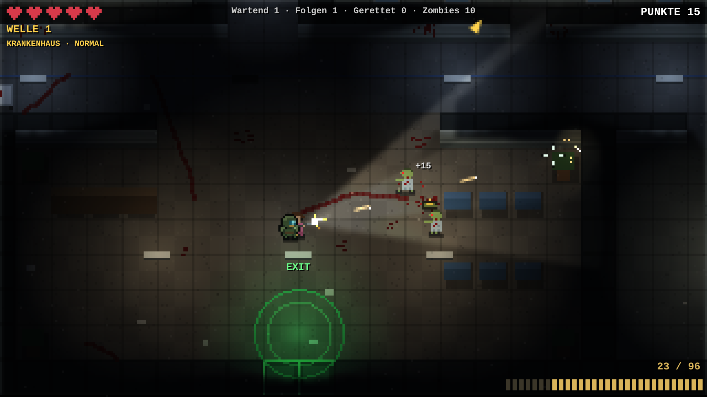
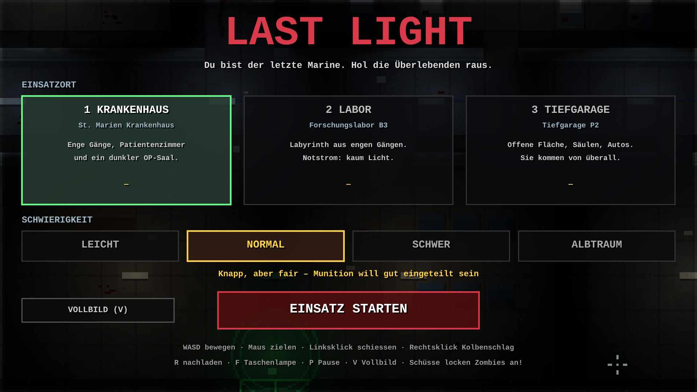
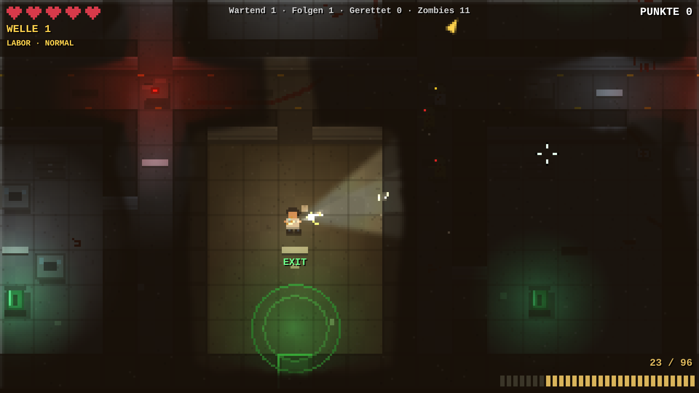
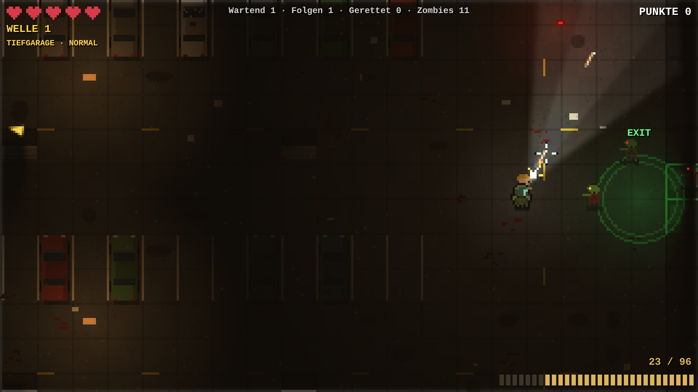

# Last Light – 2D Pixel Zombie Shooter

You are the last marine in a city overrun by zombies. Fight your way through dark hospitals, labs and parking garages, find the survivors and lead them to the exit alive.

**▶ Play in your browser:** https://mail688.github.io/last-light/

## Features
- **3 levels:** St. Marien Hospital (narrow corridors), Research Lab B3 (a maze with almost no power), Parking Garage P2 (open space, zombies come from every side)
- **4 difficulty levels:** Easy, Normal, Hard, Nightmare
- **Rescue mechanic:** survivors follow you along the path you walked. If a zombie bites one, she turns into a zombie herself.
- **Dynamic lighting:** a raycast flashlight with shadows, flickering ceiling lights, red emergency lights, and a muzzle flash that lights up the room
- **Smart zombies:** flow-field pathfinding through the corridors, gunshots attract nearby zombies, plus 3 types: Walker, Runner, Tank
- **Survival:** limited ammo, ammo boxes and medkits, rifle-butt melee attack
- **Procedural sound:** every sound is synthesized live with the Web Audio API (gunshot with reverb, reload, growls with stereo position)
- **Zombie Coins & shop:** earn ZC (+10 per kill, +50 per rescue, +100 per wave survived) and buy 4 extra weapons (SMG, shotgun, sniper rifle, minigun) and 5 marine skins. Progress is saved in the browser.
- **Everything in one file:** no engine, no libraries, no images. Pure HTML5 Canvas + JavaScript.

## Controls
At startup you choose **Computer** (mouse & keyboard) or **Phone/Tablet** (touch controls: left thumb moves, right thumb aims (push to the edge to fire), buttons for melee, reload, flashlight and pause).

**Computer:**
| Key | Action |
|---|---|
| WASD | Move |
| Mouse | Aim |
| Left click | Shoot |
| Right click | Rifle-butt strike |
| R | Reload |
| F | Flashlight on/off |
| P / Esc | Pause |
| V | Fullscreen |

## Running it
- **Phone app (PWA):** open the game link in Safari (iPhone) or Chrome (Android) and choose *Add to Home Screen*. It then starts fullscreen with its own icon and also works offline.
- **Browser:** open `index.html`, or use the GitHub Pages link above
- **Windows app:** `launcher/` contains a small Go program that bundles the game into an `.exe` and opens it in its own fullscreen window (`GOOS=windows go build -ldflags "-H=windowsgui" -o "Last Light.exe"`, with `index.html` copied into `launcher/game/` first)

## Screenshots

## Tech
HTML5 Canvas 2D (320×180 pixel internal resolution, scaled up), color lightmap with multiply blending, raycast shadows, BFS flow field for pathfinding, Web Audio API with a convolver reverb.
